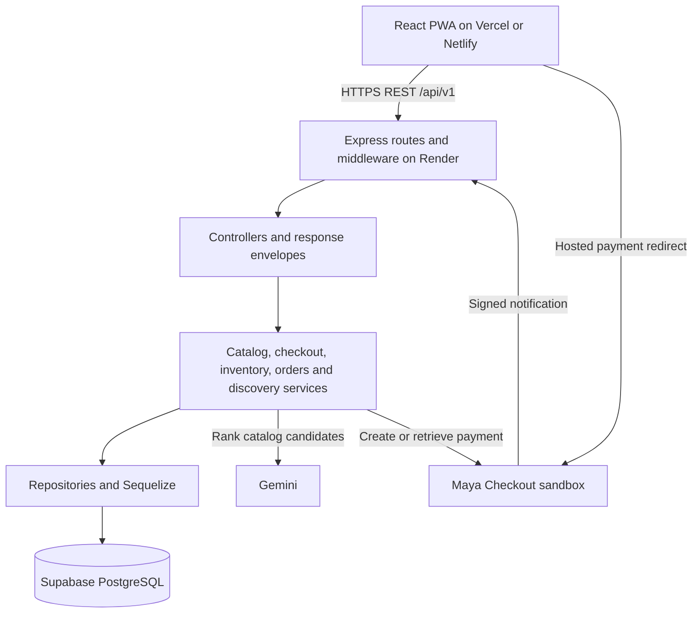
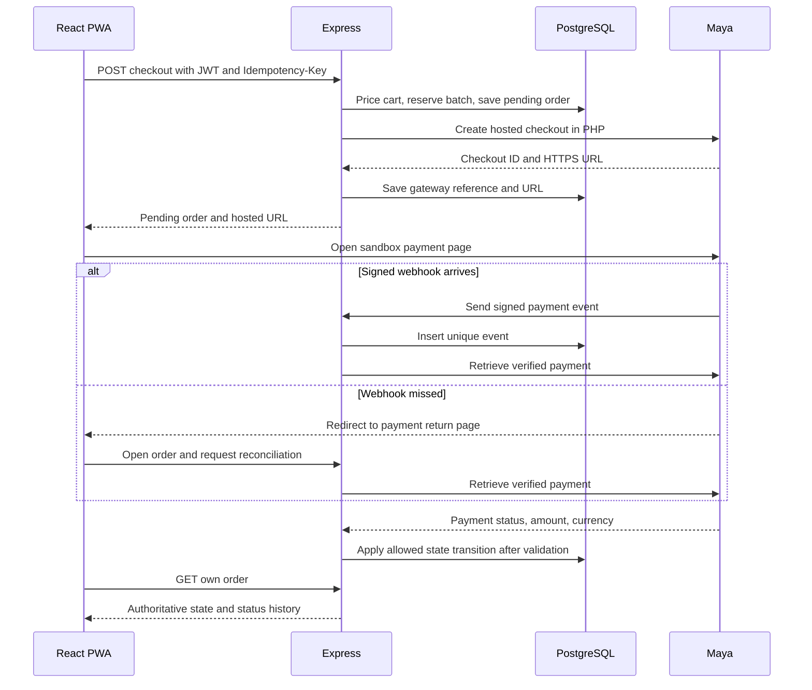

# Architecture and checkout

The Express application deploys as a single layered API. Maya and Gemini are external integrations. The React build has its own dependencies and public configuration. The service worker precaches route bundles, caches public catalog GETs and product photos, and never handles private API data in its runtime cache. The browser stores a separate last-viewed cart snapshot for offline display.

The return URL contains only the order identifier. Ownership checks apply on read and reconciliation. The admin can also reconcile from the order list. A valid payment received after cancellation or expiry is flagged for review.
