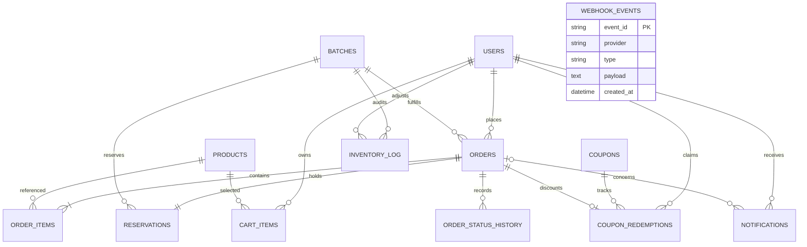

# Database design

Kape uses PostgreSQL through Sequelize. Supabase hosts the deployed database. Set `DATABASE_URL`, run `npm run seed`, and then run `npm run images` to attach the bundled coffee photos. The seed creates 22 products in five categories, one admin, two customers, three coupons, and initial roast batches if the batch table is empty. Add another future batch through Admin after the seed cutoffs pass.

| Table | Key data and integrity |
|---|---|
| users | Unique email, bcrypt hash and customer/admin role. |
| products | Unique name, roast, category, tasting notes, image URL and nonnegative base price. |
| batches | Roast date, cutoff, capacity and reserved units constrained to 0 through capacity. |
| inventory_log | Batch, previous/new capacity, change reason, administrator and time. |
| coupons | Code primary key, type/value, minimum spend, expiration, usage limits and active flag. |
| cart_items | Unique user/product/size/grind combination. Quantity 1–10. |
| orders | Customer, batch, status, centavo totals, delivery details and payment state. Unique customer/idempotency-key pair and unique gateway reference. Indexed on status and creation time. |
| order_items | Product reference and price/name/variant snapshot. Product deletes are blocked when order items reference them. |
| reservations | Unique order reference, batch, units, expiration and lifecycle. The order items preserve the per-product split. |
| order_status_history | Order state transitions, actor, timestamp and optional note. |
| coupon_redemptions | Unique order reference, customer and coupon. Released on failed or expired orders. |
| webhook_events | Unique provider event ID. Kept separately because unmatched signed events can also arrive. |
| notifications | Customer, optional order, message and timestamp. |

`backend/src/models/index.js` is the schema source. `checkoutService.js` creates the order, line snapshots, reservation, coupon redemption and initial history in one transaction. `batches.js` uses a conditional UPDATE so concurrent customers cannot reserve the same last unit. Currency uses integer PHP centavos throughout the database.
